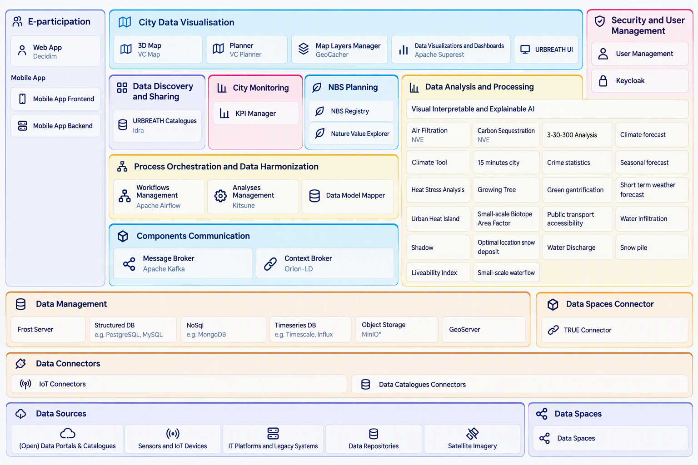

# URBREATH

## Project Overview

**URBREATH** is a Horizon Europe project focusing on boosting **social interactions, inclusion, equitability, and liveability** in cities. The project aims to put **communities at the heart of decision-making** for regional and local sustainable development.

To achieve this, the project team will develop, implement, demonstrate, validate, and replicate a comprehensive, **community participation and Nature-Based Solution (NBS)-driven paradigm** within the spectrum of urban revitalization, resilience, and climate neutrality. These methodological approaches will be enhanced via **social innovation practices, digital twins, and artificial intelligence tools**.

## What We Do

URBREATH is about reimagining urban living, where concrete jungles give way to lush green havens. By weaving nature into the fabric of our cities – from expansive green roofs to vibrant urban forests and thriving wetlands – we aim to:

* Combat the urban heat island effect
* Mitigate flood risks
* Purify our air

## What We Aim For

We aim to transform our cities from the ground up, making them not only **sustainable** but also **resilient** against the ever-growing threats of a warming world.

## Our Expectations

Our goal is to make our cities more **livable and inclusive** and to establish a **model for urban areas** to play a central role in addressing climate change, transforming our vulnerability into a powerful defense.

---
## The URBREATH Toolbox
The URBREATH Toolbox is designed to provide support functionalities for collaborative projects focused on Nature Based Solutions, that require the interactions between interdisciplinary experts and heterogeneous stakeholders. To enable effective collaboration among them, the URBREATH Toolbox provides a unified framework that facilitates coordination, data integration, and sustainable project outcomes. The logical architecture of the URBREATH Toolbox is built around the following key characteristics:
* Promotion of cross-disciplinary collaboration 
* Centralise discovery and access to heterogeneous and scattered data. 
* Adaptiveness and flexibility, to allow the reuse of the toolbox over time for different projects. 
* Facilitate stakeholder engagement and communication, ensuring that local voices are heard and that projects meet local needs 
* Ability to perform simulation and analysis, enabling stakeholders to model and compare different scenarios of interventions and assess the potential impacts of NBS projects. 
* Define, track, and report on key performance indicators. 
* Ability to perform data visualisation, transforming complex data into understandable visual representations such as charts, graphs, and 2D/3D maps.

The URBREATH Toolbox leverages a logical architecture organised in ten macro areas covering the main functional needs of the platform:
* **Data Discovery and Sharing** provides a unified access point to discover datasets, tools, models, data sources and other resources managed through the URBREATH Toolbox
* **City Data Visualisation** includes user interfaces for data visualisation and interaction with toolbox components
* **City Monitoring** supports the monitoring of city parameters and KPIs
* **Data Analysis and Processing** covers analytics and simulations tailored to the needs of the URBREATH pilots
* **NBS Planning** supports decision makers and planners in designing and planning Nature-Based Solutions
* **E-Participation** enables stakeholder engagement and participatory processes for planning, monitoring and evaluating interventions
* **Data Management** supports the collection and management of heterogeneous data sources and interoperability with data spaces
* **Components Communication** enables communication among the different components of the toolbox
* **Process Orchestration** supports the definition, execution and orchestration of complex workflows involving multiple components
* **Security** manages users, roles, permissions, authentication and authorisation
  
 

The tools developed within the project are listed below under the macro area they are mapped to, together with their descriptions and corresponding repositories.
This information is continuously updated as development progresses.
### Data Discovery and Sharing
**GeoNetwork**

GeoNetwork is a catalog application to manage spatially referenced resources. It provides powerful metadata editing and search functions as well as an interactive web map viewer.

[Repository of the official Docker image](https://github.com/URBREATH/docker-geonetwork)

**Urbreath Catalogue (Idra)**

Idra is a web application able to federate existing Open Data Management Systems (ODMS) based on different technologies providing a unique access point to search and discover open datasets coming from heterogeneous sources. Idra uniforms representation of collected open datasets, thanks to the adoption of international standards (DCAT-AP) and provides a set of RESTful APIs to be used by third party applications.
Idra supports natively ODMS based on CKAN, DKAN, Socrata, Orion Context Broker (NGSI v2, NGSI-LD) and many other technologies: Idra provides also a set of APIs to federate ODMS not natively supported. In addition, it is possible to federate generic open data portals, that don't expose API, using the web scraping functionality or providing a dump file of the datasets in DCAT-AP format. Furthermore, Idra provides a SPARQL endpoint in order to perform queries on 5 stars RDF linked open data collected from federated ODMS and allows to easily create charts based on federated open datasets (through DatalEt-Ecosystem Provider DEEP )

Repositories:
* [Idra](https://github.com/URBREATH/Idra)
* [IdraPortal-ngx](https://github.com/URBREATH/IdraPortal-ngx)

### City Data Visualisation
**3D City Database Importer/Exporter**

The 3D City Database Importer/Exporter is a Java based client for the 3D City Database. It allows for high-performance loading and extracting 3D city model data.
The 3D City Database Importer/Exporter comes with both a Graphical User Interface (GUI) and a Command Line Interface (CLI). The CLI allows for employing the tool in batch processing workflows and third-party applications.

[Repository](https://github.com/URBREATH/3dcitydb-importer-exporter)

**Map Layers Manager (GeoCacher)**

GeoCacher is a backend service designed to support a graphical dashboard for visualizing geospatial data. Its primary purpose is to interface with a FIWARE ORION Context Broker to extract and temporarily store (cache) data.
GeoCacher allows to retrieve filters and geospatial data from the ORION Context Broker, support CRUD (Create, Read, Update, Delete) operations to save and manage user searches on a supporting MongoDB database and upload and display custom GeoJSON files on the dashboard.

Repositories: 
* [Frontend](https://github.com/URBREATH/GeoCacher-frontend)
* [Backend](https://github.com/URBREATH/GeoCacher-backend)

**Data Visualisation and Dashboards (Apache Superset)**

This data visualization tool is built on top of Apache Superset. The dashboard allows users to explore, analyse, and monitor data in real time through an interactive and customizable interface. It offers dynamic and interactive visualizations, advanced filters for targeted analysis, and a scalable, modular architecture powered by Apache Superset. The tool is configurable with multiple levels of access and security and provides a web-based, user-friendly interface. The main goal of the project is to provide a ready-to-use solution for building business dashboards that enable organizations to make data-driven decisions with ease.

[Repository](https://github.com/URBREATH/Superset)

**3D Map (VC Map)**

VC Map is an Open-Source JavaScript framework and API for building dynamic and interactive maps on the web. It can display 2D data, oblique imagery and massive 3D data including terrain data, vector data, mesh models, and point clouds making it easy for users to explore and interact with the data in an integrated and high-performance map application. VC Map apps can be rendered in all modern web browsers and on both desktop and mobile devices, bringing the map to where the user is. VC Map is built upon open, proven, and reliable GIS and web technologies such as OpenLayers and Cesium for the visualization of 2D and 3D geo-data.

Repositories:
* [Core](https://github.com/URBREATH/vc-map-core)
* [UI](https://github.com/URBREATH/vc-map-ui)
### City Monitoring
**KPI Manager**

The KPI Manager is a web-based application for defining, calculating, monitoring, and visualising Key Performance Indicators (KPIs).
It provides a centralised environment for collecting and processing KPI-related data from different sources and presenting the resulting indicators through interactive dashboards and visualisations.
The application allows users to configure KPIs according to specific business or project requirements, define their calculation logic, associate them with relevant measures, and monitor their evolution over time.

[Repository](https://github.com/URBREATH/KPI-Manager)
### Data Analysis and Processing
**Heat Stress Analysis**

Heat Stress is a geospatial analysis tool that quantifies and simulates Land Surface Temperature (LST) to support climate resilient urban planning.

[Repository](https://github.com/URBREATH/Impact-of-NBS-on-Heat-Stress)

**Urban Heat Islands**

The Urban Heat Island (UHI) algorithm identifies and monitors areas within cities that are significantly warmer than their surrounding rural zones.

[Repository](https://github.com/URBREATH/Urban-Heat-Islands)

**Shadow Modelling (Shadowmap)**

Shadowmap analyses the temporal shading of a selected area in a Cesium 3D scene. For a selected date, it samples the scene between estimated sunrise and sunset and reports the proportion of shaded and unshaded pixels within a polygon. 

[Repository](https://github.com/URBREATH/shadow-map-analysis)

**Infiltration Model** 

The NBS Infiltration Model provides infiltration analysis for various nature-based solutions in the Leuven area, including rain gardens, bioswales, permeable pavement, green roofs, constructed wetlands, urban forests, and infiltration trenches.

[Repository](https://github.com/URBREATH/infiltration-model)

**Biotope Area Factor**

The Biotope Area Factor (BAF) Calculator evaluates the ecological quality of selected planning areas. It calculates polygon areas, weighted biotope areas, and the resulting BAF; groups results by surface type; and presents them in a result table.

[Repository](https://github.com/URBREATH/small-scale-baf)

**3-30-300 Analysis**

This viewer provides a simple, people-centered way to explore and analyse urban greenery directly on a map following the 3-30-300 rule:
*	At least 3 trees visible from every home
*	At least 30% tree canopy or vegetation cover in every neighbourhood 
*	A maximum distance of 300 meters to the nearest green space

[Repository](https://github.com/URBREATH/vito_3-30-300)

### NBS Planning
**Nature Value Explorer**

The Nature Value Explorer focuses on pragmatic methods that value ecosystem services and helps planners, land managers and policy makers to map nature's socio-economic importance.

[Repository](https://github.com/URBREATH/NatureValueExplorer)
### E-Participation
**Web app (Decidim)**

Decidim is a participatory democracy framework, written in Ruby on Rails, originally developed for the Barcelona City government online and offline participation website. Installing these libraries will provide you a generator and gems to help you develop web applications like the ones found on example applications or like our demo application.

[Repository](https://github.com/URBREATH/decidim)

Decidim Modules Extensions:
* [decidim-module-apiauth](https://github.com/URBREATH/decidim-module-apiauth)
* [decidim-module-idra](https://github.com/URBREATH/decidim-module-idra)
* [decidim-module-iframe](https://github.com/URBREATH/decidim-module-iframe)
* [decidim-module-keycloak](https://github.com/URBREATH/decidim-module-keycloak)
* [decidim-module-nbs_stories](https://github.com/URBREATH/decidim-module-nbs_stories)
* [decidim-module-urbreath-ui](https://github.com/URBREATH/decidim-module-urbreath-ui)
* [decidim-module-whiteboard](https://github.com/URBREATH/decidim-module-whiteboard)

**Mobile app**

The e-participation mobile app is a native app (works on iPhones and Android phones) that lets regular citizens participate in decisions about green spaces, urban nature, and environmental improvements in their city. It includes a city suggestion box, a neighborhood forum, and a project tracker focused on nature and the environment.

[Repository](https://github.com/URBREATH/e-participation-mobile-app)
### Data Management
**FROST Server**

The FRaunhofer Opensource SensorThings-Server is the first complete, open-source official reference implementation of the OGC SensorThings API. Depending on specific requirements, plugins allow to extend and even replace the data model.

[Repository](https://github.com/URBREATH/FROST-Server)

**GeoServer**

GeoServer is an open-source software server written in Java that allows users to share and edit geospatial data. Designed for interoperability, it publishes data from any major spatial data source using open standards.
GeoServer is the reference implementation of the Open Geospatial Consortium (OGC) Web Feature Service (WFS) and Web Coverage Service (WCS) standards, as well as a high performance certified compliant Web Map Service (WMS), compliant Catalog Service for the Web (CSW) and implementing Web Processing Service (WPS). GeoServer forms a core component of the Geospatial Web.

[Repository](https://github.com/URBREATH/geoserver)

**Object Storage (MinIO)**

MinIO is a High Performance Object Storage released under GNU Affero General Public License v3.0. It is API compatible with Amazon S3 cloud storage service. Use MinIO to build high performance infrastructure for machine learning, analytics and application data workloads.

[Repository](https://github.com/URBREATH/minio)
### Components Communication
**Context Broker (Orion-LD)**

Orion-LD is a Context Broker and CEF building block for context data management, implementting both the NGSI-LD API and the NGSIv2 API. It is currently a fork of the original Orion Context Broker extending support to add NGSI-LD and linked data concepts. Orion-LD follows the ETSI specification for NGSI-LD and has been tested to be a stable and fast NGSI-LD broker with near compliance to the version 1.6.1 of the NGSI-LD API specification (and some features from newer releases).

[Repository](https://github.com/URBREATH/context.Orion-LD)
### Process Orchestration
**Workflow Management and Execution (Apache Airflow)**

Apache Airflow (or simply Airflow) is a platform to programmatically author, schedule, and monitor workflows.
Airflow allows to author workflows as directed acyclic graphs (DAGs) of tasks. The Airflow scheduler executes the tasks on an array of workers while following the specified dependencies. Rich command line utilities make performing complex surgeries on DAGs a snap. The rich user interface makes it easy to visualize pipelines running in production, monitor progress, and troubleshoot issues when needed.

Repositories: 
* [airflow](https://github.com/URBREATH/airflow)
* [airflow-dags](https://github.com/URBREATH/airflow-dags)
### Security
**User Manager**

User manager is responsible to handle authentication process inside Urbreath. It connects with Keycloak and routes all requests to authenticate users, refresh tokens, manage users and request information regarding their authorization in the system.
It exploits OAuth2.0 and OpenID protocols integrated with Spring Security with configured Request Filters to increase the security of the application and generate JWT Tokens for users.

[Repository](https://github.com/URBREATH/user-manager)

---
